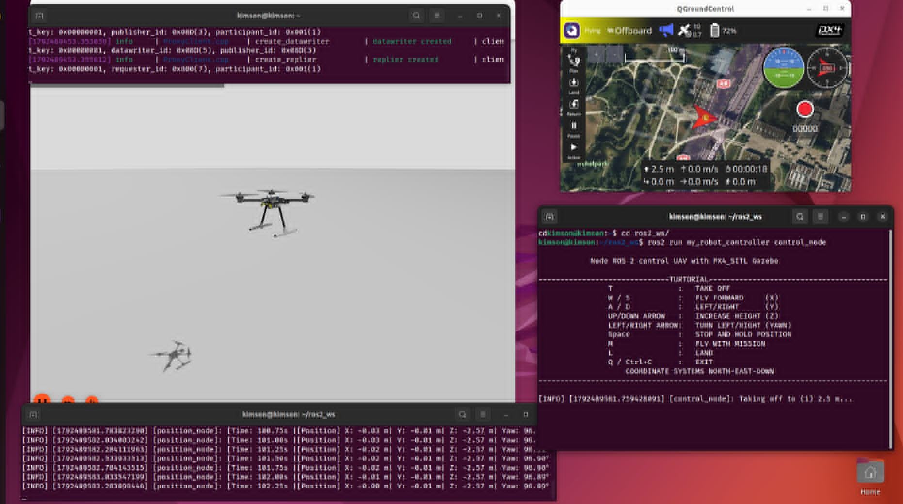
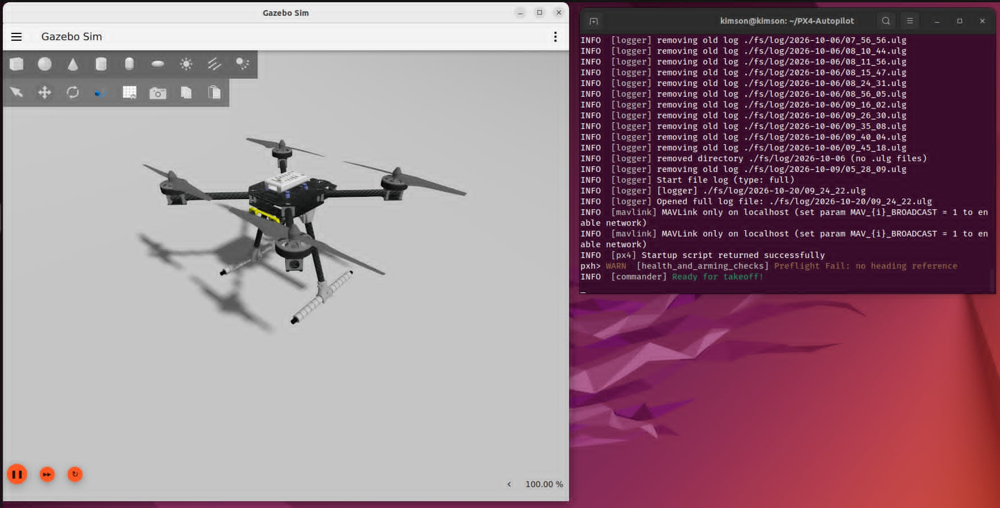
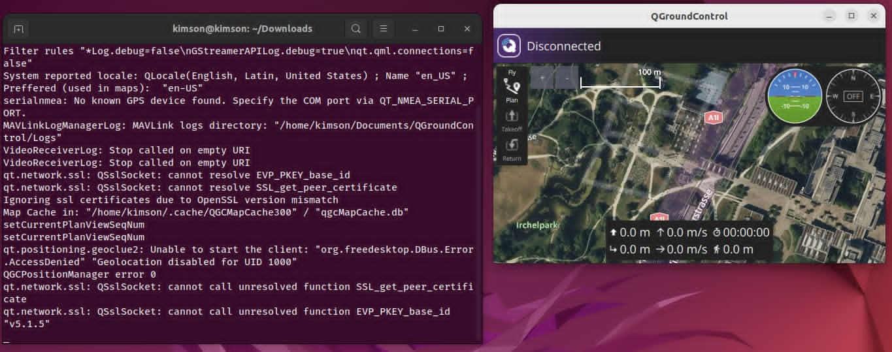
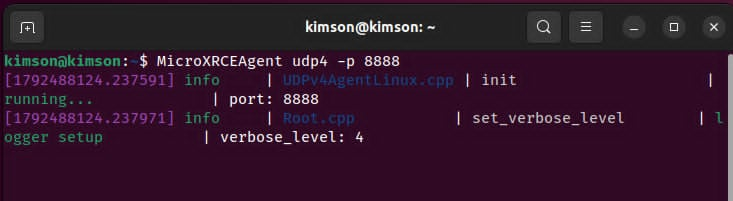
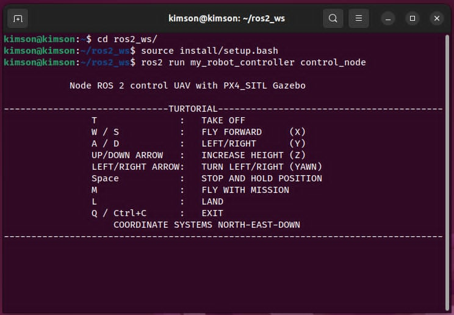
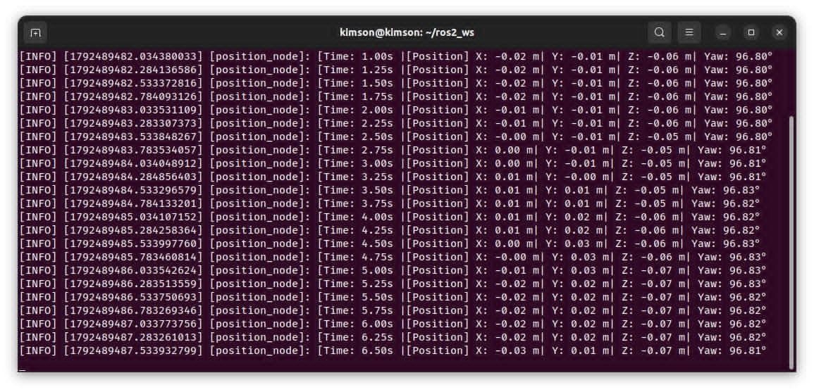
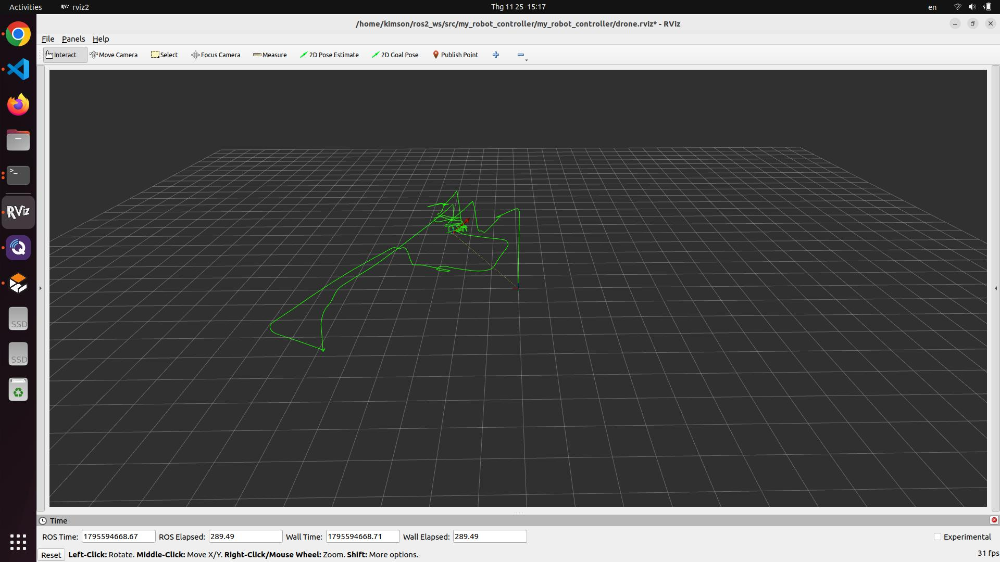

# Controlling-UAV-Simulation
A simulation controlling UAV by keyboards and mission with PX4-AutoPilot, Gazebo Sim 8, ROS2 Humble 

## Table of Contents
- [INTRODUCTION](#introduction)
- [REQUIREMENTS](#requirements)
- [RUN SIMULATION](#run-simulation)
  - [MANUAL MODE](#manual-mode)
  - [MISSION MODE](#mission-mode)
- [NOTE](#note)
- [CREDITS AND REFERENCES](#credits-and-references)
- [THANKS TO](#thanks-to)

## INTRODUCTION
&emsp;This project aims to control and simulation UAV in Gazebo Sim 8 by PX4-AutoPilot and ROS2 Humble. UAV can control by keyboards WASD and arrow keys. Moreover it can create, adjust and run mission. Besides, it also has a position node and RVIZ to track continuously the coordinate, direction and trajectory of UAV .



## REQUIREMENTS
- Gazebo Sim 8
- PX4-AutoPilots
- MicroXRCEAgent
- ROS2 Humble
- RViz V2

## RUN SIMULATION
  After download the project, open new terminal and alias this following command in your computer helping next time to start easier.

```bash
alias drone-basic = 'Controlling-UAV-Simulation-main/start_drone.sh custom gz_x500'
alias drone-stope = 'tmux kill-session -t drone 2>/dev/null; pkill -9 -x px4; pkill -9 -f "gz sim"; pkill -9 -x MicroXRCEAgent; pkill -9 -f rviz2; pkill -9 -f QGroundControl'
```

  It's help you start and bunch of programs easier and safetier for the next time instead of open terminal repeatedly.
  Moreover, you can change the model or world in file 'start_drone.sh' by changing the variable or change in command by link in the alias command, for example: 

```bash
alias drone-lidar-2d = 'Controlling-UAV-Simulation-main/start_drone.sh custom gz_x500_lidar_2d'
```

  Terminal 1: PX4-AutoPilot 



  Terminal 2: QGroundControl (this is in my laptop, you can change directory base on your folder position)



  Terminal 3: MicroXRCEAgent



  Terminal 4: Control Node (this is in my laptop, you can change directory base on your folder position)



  Terminal 5: RViz display the trajectory, direction and terminal display the position and status of drone






## HOW TO CONTROL 
&emsp;Control node has 2 control mode 'Manual' or 'Mission'. Manual mode is the mode controling UAV by keyboards WASD and arrow keys to control the UAV. Mission mode is the mode UAV run automatically base on mission they're setting in the program. You can change the mission base on the setpoint in DEFAUT_MISSION in control_node file.
  
### MANUAL MODE
&emsp;With manual mode, you can control your UAV by keyboards following this instruction:
T: Take-off

W/S: Fly forward

UP/DOWN ARROW: Increase height

LEFT/RIGHT ARROW: Turn left/right

SPACE: Stop and hold position

M: Fly with mission

L: Land

Q/CTRL+C: Exit

### MISSION MODE
&emsp;With mission mode, you can create a mission by setting setpoints then UAV will fly through all setpoints you created before. Mission can be changed via DEFAULT_MISSION variables. You can create more setpoints or adjust coordinate of setpoints. This is a example of my DEFAULT_MISSION: 
```bash
DEFAULT_MISSION = [
    dict(x=1.0,  y=0.0, z=-3.0,  yaw=45.0,  hold=5.0),
    dict(x=10.0, y=0.0, z=-3.0,  yaw=0.0,   hold=5.0),
    dict(x=5.0,  y=5.0, z=-5.0,  yaw=90.0,  hold=5.0),
    dict(x=7.0,  y=5.0, z=-10.0, yaw=180.0, hold=5.0),
    dict(x=8.0,  y=0.0, z=-9.0,  yaw=-90.0, hold=5.0),
    dict(x=0.0,  y=6.0, z=-4.5,  yaw=0.0,   hold=5.0),
]
```

## NOTE


## CREDITS AND REFERENCES
&emsp;This project is based on:

[ROS2 and PX4 Tutorial | Simulated Offboard Mode](https://www.youtube.com/watch?v=8gKIP0OqHdQ&t=19s)

[ROS2_PX4_Offboard_Example](https://github.com/ARK-Electronics/ROS2_PX4_Offboard_Example.git)

## THANKS TO
[Embedded Networking Labrotatory](https://www.facebook.com/lab411) - Hanoi University of Science and Technology

Tran Luong Duy 202113751 Hanoi University of Science and Technology 
