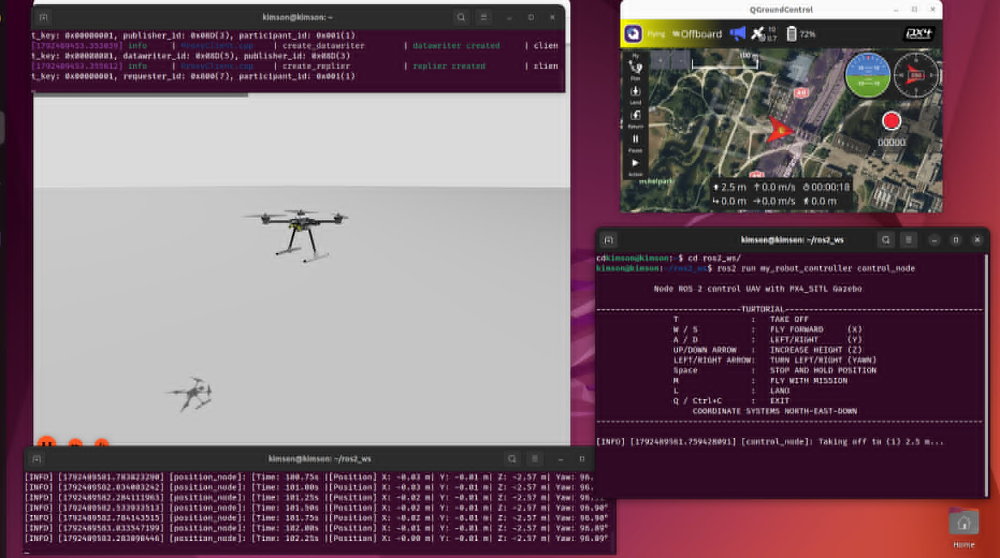
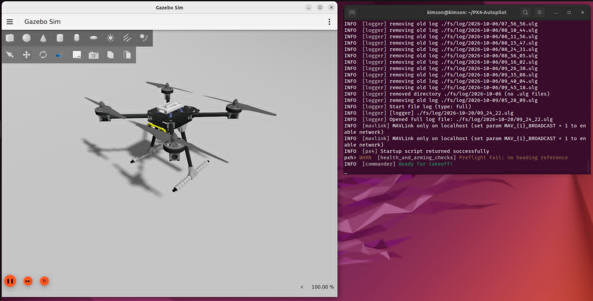
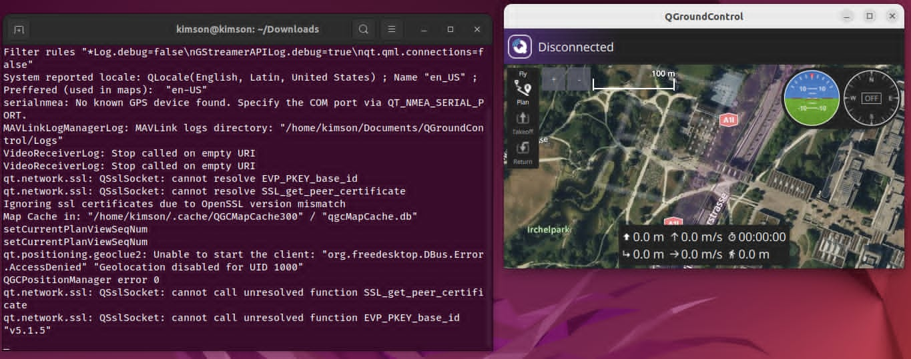
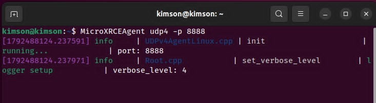
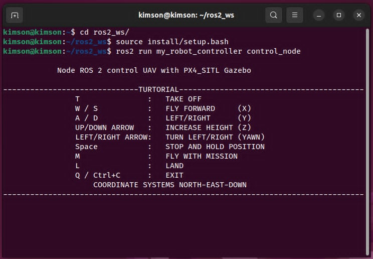
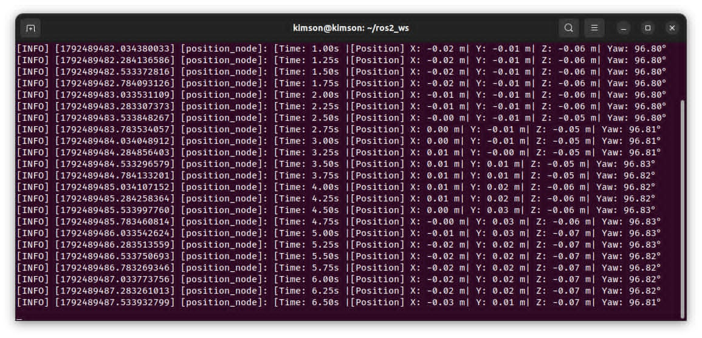

# Controlling-UAV-Simulation
A simulation controlling UAV by keyboards and mission with PX4-AutoPilot, Gazebo Sim 8, ROS2 Humble 

## Table of Contents
- [INTRODUCTION](#introduction)
- [RUN SIMULATION](#run-simulation)
  - [MANUAL MODE](#manual-mode)
  - [MISSION MODE](#mission-mode)
- [NOTE](#note)
- [CREDITS AND REFERENCES](#credits-and-references)
- [THANKS TO](#thanks-to)

## INTRODUCTION
&emsp;This project aims to control and simulation UAV in Gazebo Sim 8 by PX4-AutoPilot and ROS2 Humble. UAV can control by keyboards WASD and arrow keys. Moreover it can run mission by setpoint and adjust and create. Besides, it also has a position node to track the coordinate of UAV.


## RUN SIMULATION
  After download 2 programs and execute and build it, run 4 terminal simultaneously in 4 different terminals. 
  
  Terminal 1: PX4-AutoPilot 
```bash
cd PX4-AutoPilots/
make px4_sitl gz_x500
```


  Terminal 2: QGroundControl (this is in my laptop, you can change directory base on your folder position)
```bash
cd Downloads/
./QGroundControl
```


  Terminal 3: MicroXRCEAgent
```bash
MicroXRCEAgent udp4 -p 8888
```


  Terminal 4: Control Node (this is in my laptop, you can change directory base on your folder position)
```bash
cd ros2_ws/
source install/setup.bash
ros2 run my_robot_controller control_node
```


  Terminal 5: Position Node (this is in my laptop, you can change directory base on your folder position)
```bash
cd ros2_ws/
source install/setup.bash
ros2 run my_robot_controller position_node
```


## HOW TO CONTROL 
&emsp;Control node has 2 control mode 'Manual' or 'Mission'. Manual mode is the mode controling UAV by keyboards WASD and arrow keys to control the UAV. Mission mode is the mode UAV run automatically base on mission they're setting in the program. You can change the mission base on the setpoint in DEFAUT_MISSION in control_node file.
  
### MANUAL MODE
&emsp;With manual mode, you can control your UAV by keyboards following this instruction:
T: Take-off

W/S: Fly forward

UP/DOWN ARROW: Increase height

LEFT/RIGHT ARROW: Turn left/right

SPACE: Stop and hold position

M: Fly with mission

L: Land

Q/CTRL+C: Exit

### MISSION MODE
&emsp;With mission mode, you can create a mission by setting setpoints then UAV will fly through all setpoints you created before. Mission can be changed via DEFAULT_MISSION variables. You can create more setpoints or adjust coordinate of setpoints. This is a example of my DEFAULT_MISSION: 
```bash
DEFAULT_MISSION = [
    dict(x=1.0,  y=0.0, z=-3.0,  yaw=45.0,  hold=5.0),
    dict(x=10.0, y=0.0, z=-3.0,  yaw=0.0,   hold=5.0),
    dict(x=5.0,  y=5.0, z=-5.0,  yaw=90.0,  hold=5.0),
    dict(x=7.0,  y=5.0, z=-10.0, yaw=180.0, hold=5.0),
    dict(x=8.0,  y=0.0, z=-9.0,  yaw=-90.0, hold=5.0),
    dict(x=0.0,  y=6.0, z=-4.5,  yaw=0.0,   hold=5.0),
]
```
  
## NOTE
&emsp;REMEMBER, NOT SHUTDOWN THE PROGRAM BY PRESS CTRL+C IN TERMINAL 
  
&emsp;Because the Gazebo's World will run in the background and next time you can't create world with UAV.

## CREDITS AND REFERENCES
&emsp;This project is based on:

[ROS2 and PX4 Tutorial | Simulated Offboard Mode](https://www.youtube.com/watch?v=8gKIP0OqHdQ&t=19s)

[ROS2_PX4_Offboard_Example](https://github.com/ARK-Electronics/ROS2_PX4_Offboard_Example.git)

## THANKS TO
[Embedded Networking Labrotatory](https://www.facebook.com/lab411) - Hanoi University of Science and Technology

Tran Luong Duy 202113751 Hanoi University of Science and Technology 
